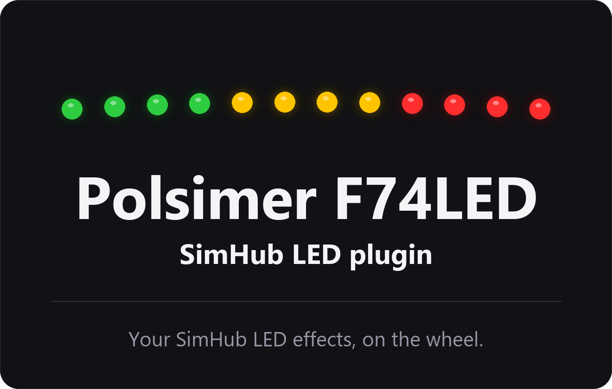
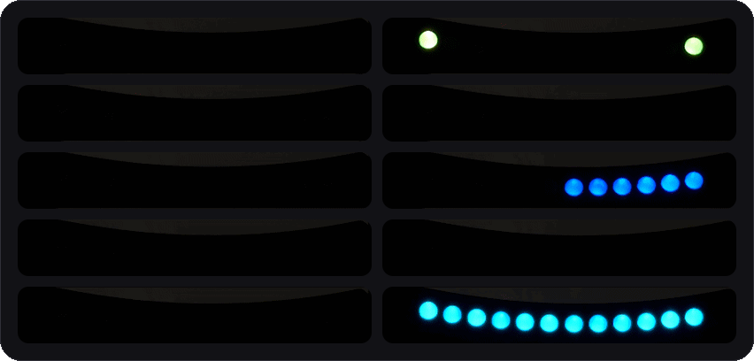
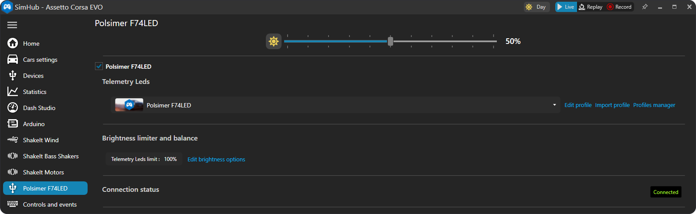
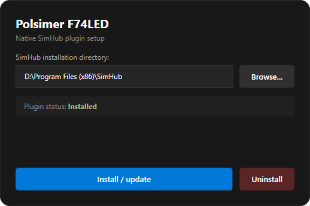

<div align="center">

<p></p>

<a href="https://github.com/kpulka247/polsimer-simhub-plugin/actions" title="GitHub Actions Workflow Status"></a>
<a href="https://github.com/kpulka247/polsimer-simhub-plugin/releases" title="GitHub Release"></a>
<a href="https://github.com/kpulka247/polsimer-simhub-plugin/releases" title="GitHub Downloads"></a>
<a href="https://github.com/kpulka247/polsimer-simhub-plugin/blob/main/LICENSE" title="GitHub License"></a>

<a href="https://www.simhubdash.com/" title="SimHub"></a>
<a title="Platform"></a>

</div>

## Overview

The Polsimer F74LED wheel has 12 LEDs, and this plugin lets SimHub drive them. Every effect you set up in SimHub's LED Effects Engine, such as shift lights, flags, and pit limiter, shows on the wheel. The plugin runs inside SimHub and talks to the wheel over USB HID, so no other app has to run in the background.

<div align="center">



</div>

## Features

- 🔌 **Runs inside SimHub.** The plugin sends LED frames straight to the wheel over USB HID and checks the connection 20 times a second.
- 🎮 **Every SimHub LED effect.** Game telemetry, shift lights, and flag colors from your SimHub profile light the wheel's 12 LEDs.
- ☀️ **Real brightness control.** SimHub's brightness slider and Day and Night presets set the wheel's own LED brightness.
- 🔁 **Recovers on re-plug.** Unplug the wheel or change game, and the effects pick up in sync again.
- 💾 **Remembers your settings.** Brightness and wheel state stay the same after a restart.

## Screenshots



## Installation

> [!TIP]
> **[Download the latest version](https://github.com/kpulka247/polsimer-simhub-plugin/releases/latest/download/Polsimer-F74LED-SimHub.zip)**, extract it, and run `setup.exe`.

> [!WARNING]
> The installer is not code-signed. If Windows shows **Windows protected your PC**, click **More info**, then **Run anyway**.



1. Extract `Polsimer-F74LED-SimHub.zip`.
2. Close SimHub.
3. Run `setup.exe` and click **Install / update**. The installer finds your SimHub folder. Click **Browse...** if it picks the wrong one.
4. Open SimHub, click **Add/remove features** at the bottom of the left sidebar, and check **Polsimer F74LED**.

To remove the plugin and its saved settings, run `setup.exe` and click **Uninstall**.

<details>
<summary>Install by hand</summary>

1. Copy `Polsimer.SimHub.Plugin.dll` into your SimHub folder, for example `C:\Program Files (x86)\SimHub\`.
2. Open SimHub, click **Add/remove features**, and check **Polsimer F74LED**.

</details>

## Usage

Open the **Polsimer F74LED** tab in SimHub's left menu. The tab shows whether the wheel is connected and has the brightness slider. Choose the effects in SimHub's LED Effects settings, the same way as for any other LED device.

<details>
<summary>Troubleshooting</summary>

- **The tab is missing.** Click **Add/remove features** at the bottom of SimHub's left sidebar and check **Polsimer F74LED**.
- **The LEDs do not change.** Check the USB cable and the **Connection status** in the Polsimer F74LED tab.
- **Settings reset after a restart.** Close SimHub with the window close button or the tray icon. Ending the task in Task Manager skips the save.

</details>

## Development & Build

You need Windows, the [.NET SDK](https://dotnet.microsoft.com/download), and SimHub installed.

```powershell
.\build.ps1 -Version 1.0.0 -SimHubDir "C:\Program Files (x86)\SimHub"
```

The build writes `release\Polsimer-F74LED-SimHub-v<version>.zip`. The release uploads it as `Polsimer-F74LED-SimHub.zip`, so the download link in this README always gets the latest version. Without `-SimHubDir`, it uses the SimHub path in [`src/Polsimer.SimHub.Plugin.csproj`](src/Polsimer.SimHub.Plugin.csproj).

The README images come from the originals in `docs/images/source/`. `installer.png` there is a window capture of `setup.exe` at 100% display scale. To render them again, run `python scripts/readme_images.py` (needs [Pillow](https://pypi.org/project/pillow/)).

[semantic-release](https://github.com/semantic-release/semantic-release) releases every push to `main`. It picks the version from [Conventional Commits](https://www.conventionalcommits.org/): `fix:` and `perf:` make a patch, `feat:` makes a minor, and `feat!:` or a `BREAKING CHANGE:` footer makes a major. `docs:`, `chore:`, `ci:`, and `refactor:` do not release.

## License

[MIT](./LICENSE).

An unofficial project, not affiliated with Polsimer or SimHub. Polsimer, F74LED, and SimHub are trademarks of their owners.

## Changelog

Changes for each release are in [GitHub Releases](https://github.com/kpulka247/polsimer-simhub-plugin/releases).
